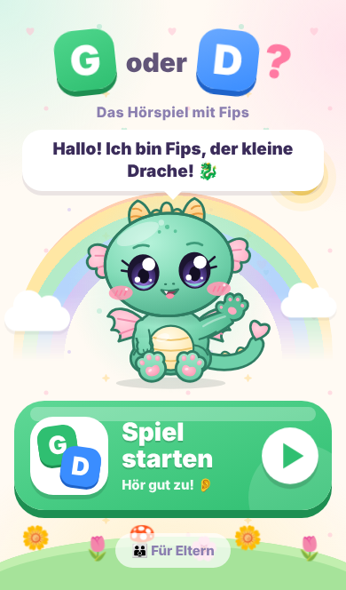
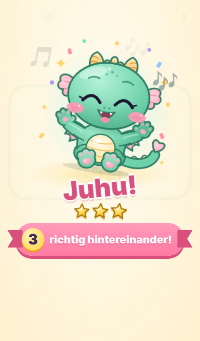
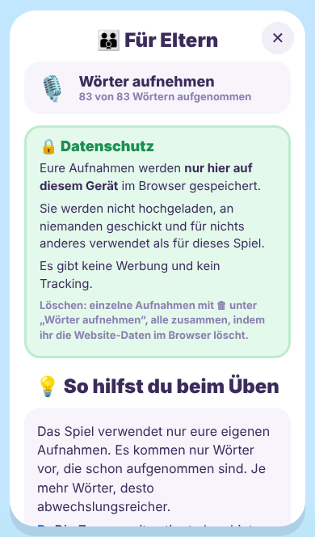

<div align="center">

<a href="https://nager-code.github.io/logopaedie-g-d/"></a>

# G oder D? – Das Hörspiel mit Fips

**Ein kleines Lernspiel im Browser, mit dem Kinder üben, die Laute G und D zu unterscheiden –<br>mit den Stimmen von Mama und Papa.**

[](https://nager-code.github.io/logopaedie-g-d/)


</div>

<table>
  <tr>
    <td align="center" width="25%"><br><b>Fips begrüßt das Kind</b></td>
    <td align="center" width="25%"><br><b>Hören und tippen</b></td>
    <td align="center" width="25%"><br><b>Fips tanzt bei Erfolgen</b></td>
    <td align="center" width="25%"><br><b>Elternbereich</b></td>
  </tr>
</table>

## 🎧 So wird gespielt

1. Ein Wort wird vorgesprochen – mit der Stimme von Mama oder Papa.
2. Das Kind tippt auf **G** 🦒 oder **D** 🦕.
3. Danach erscheint das Wort mit Bild, der gesuchte Buchstabe ist farbig markiert.

- ✅ **Richtig:** Fips springt vor Freude mit einer Drehung in die Luft.
- 🤔 **Falsch:** Fips kratzt sich verlegen am Kopf, und das Spiel zeigt, welcher Buchstabe richtig gewesen wäre.
- 🎉 **3 richtig hintereinander:** Fips tanzt – jedes Mal mit einem anderen Tanzschritt (in den letzten beiden Runden nicht mehr, da kommt gleich das Finale).
- 🔊 hört das Wort nochmal, 👀 zeigt die Lösung.

### 🏁 Das große Finale

Am Ende jeder Runde gibt es je nach Ergebnis eine von fünf Fips-Animationen – Kopf, Arme, Flügel und Schwanz bewegen sich dabei einzeln:

| Ergebnis | Fips … |
|---|---|
| unter 4 richtig | wiegt sich, nickt und winkt dir Mut zu 💚 |
| 4–5 richtig | klatscht für dich 👏 |
| 6–7 richtig | macht Freudensprünge, mit Konfetti 🎊 |
| 8–9 richtig | springt einen Salto ⭐ |
| **10 von 10** | **erlebt eine kleine Geschichte:** läuft durch eine Landschaft und speit Feuer auf das **G** – es fängt Feuer, verkohlt, Flammen schlagen hoch, dann zerbricht es in glühende Brocken und zerfällt zu Asche. Danach ist das **D** dran. Zum Schluss jubelt Fips mit Krone und Feuerwerk 👑 |

## 🐉 Fips, der kleine Drache

Fips begleitet durchs ganze Spiel: Er winkt zur Begrüßung, ist kitzelig (ein paarmal antippen: er kichert – öfter: er lacht laut – ganz oft: er kugelt sich vor Lachen auf dem Boden), freut sich über jede richtige Antwort und tanzt bei Erfolgen. Er ist in vier Posen gezeichnet – Begrüßung, Jubel, Hoppla und Tanz.

<details>
<summary><b>🤫 Psst … ein Geheimnis</b></summary>

Wer Fips auf der Startseite ganz oft ohne Pause kitzelt (25-mal), landet bei seiner **geheimen Muffin-Party** auf einer Sommerwiese – mit Picknickdecke, Wimpel- und Lichterkette, Schmetterlingen und einer kleinen Spieluhr-Melodie:

- 🧁 Muffins antippen oder mit dem Finger zu Fips ziehen – kommt einer näher, reißt er hungrig das Maul auf.
- 🎈 Mit jedem Muffin wird Fips kugelrunder: Kugelbauch mit Bauchnabel, Pausbacken, Doppelkinn – und irgendwann bekommt er Schluckauf.
- ✨ Ab und zu liegt ein **Goldmuffin** auf dem Teller, der macht doppelt satt.
- 🤭 Bauch antippen: er wabbelt wie Wackelpudding.
- 🔥 Nach sechs Muffins grummelt der Bauch, Fips läuft rot an und lässt einen riesigen Feuerstrahl raus – mit Feuerwerk am Himmel. Danach ist er wieder ganz der Alte.
- 👩‍🍳 In der **Muffin-Küche** lassen sich Muffins selbst verzieren: Förmchen und Guss aussuchen, dann bunte Streusel, Schoko-Streusel, Zuckersterne, Herzen und Kirschen drüberrieseln lassen. Den fertigen Muffin bekommt Fips – und freut sich ganz besonders.

</details>

## 🖼️ 83 gezeichnete Wörter

40 Wörter mit **D** und 40 mit **G** (dazu 3 Hörpaare), nach Schwierigkeit in Stufen geordnet – zum Beispiel *D am Wortanfang*, *G in der Wortmitte* oder *GR und GL am Anfang*. D und G am Wortende kommen nicht vor, weil sie dort wie t und k klingen.

Jedes Wort hat ein eigenes, von Hand gezeichnetes Bild – alle im gleichen Stil wie Fips: weiche Farbverläufe, farbige Umrisse, Glanzlichter und Tiere mit Fips-Augen und rosa Bäckchen.

## 👪 Für Eltern

- **Eure eigenen Stimmen:** Es gibt keine Computerstimme. Unter **👪 Für Eltern → Wörter aufnehmen** sprecht ihr die Wörter ein. Eine Anzeige hilft mit Lautstärke und Restzeit, Stille am Anfang und Ende wird automatisch abgeschnitten.
- **Schnell startklar:** Gespielt werden kann ab **5 aufgenommenen Wörtern** (G und D). Beim Aufnehmen werden die leichten Wörter zuerst vorgeschlagen, abwechselnd mit G und D. Im Spiel kommen nur Wörter vor, die schon aufgenommen sind.
- **Tipps zum Üben:** Im Elternbereich steht kurz, wie G und D gebildet werden und wie ihr gemeinsam üben könnt.

### 🔒 Datenschutz

Die Aufnahmen werden **nur auf eurem Gerät** im Browser gespeichert (IndexedDB). Sie werden nicht hochgeladen, an niemanden geschickt und für nichts anderes verwendet. Das Spiel lädt nichts von fremden Servern nach, es gibt **keine Werbung und kein Tracking**.

## 🛠️ Technik

Reines HTML, CSS und JavaScript – ohne Abhängigkeiten und ohne Build-Schritt. Genutzt werden MediaRecorder, Web Audio und IndexedDB.

<details>
<summary><b>Aufbau des Projekts</b></summary>

```
src/                    alles, was veröffentlicht wird
  index.html            Seitenaufbau, Vorschau fürs Teilen (Open Graph)
  favicon.svg           Icon
  img/fips-*.svg        Fips in vier Posen: Begrüßung, Jubel, Hoppla, Tanz
  img/share.png         Vorschaubild fürs Teilen (1200 × 630)
  img/apple-touch-icon.png  Icon für den Home-Bildschirm
  css/style.css         Design und Animationen
  js/words.js           Wortlisten, Wortpaare, Mindestanzahl Wörter
  js/pictures.js        Gezeichnete Bilder zu allen Wörtern
  js/util.js            Hilfsfunktionen und Spielzustand
  js/dragon.js          Fips: zeigt je nach Gefühl die passende Pose
  js/storage.js         Aufnahmen speichern (IndexedDB), Stille abschneiden
  js/sound.js           Aufnahmen abspielen, Geräusche und Fanfare
  js/game.js            Spiellogik und Feiern
  js/finale.js          Abschluss-Animationen (5 Stufen, 10 von 10 als Geschichte)
  js/egg.js             Easter Egg: Fips’ geheime Muffin-Party
  js/recorder.js        Aufnahme-Studio
  js/app.js             Navigation und Start
docs/                   Screenshots für diese README
tools/                  Vorlagen und Skript für Vorschaubild, Icon und Screenshots
```

</details>

<details>
<summary><b>Lokal starten und weiterentwickeln</b></summary>

```bash
python3 -m http.server -d src
```

Dann http://localhost:8000 öffnen (das Mikrofon funktioniert nur über `https://` oder `localhost`).

- **Neue Wörter** kommen in `src/js/words.js` dazu, das passende Bild in `src/js/pictures.js` (ohne Bild wird das Emoji gezeigt).
- **Vorschaubild, Icon und Screenshots neu erzeugen** (braucht [Playwright](https://playwright.dev)):

```bash
node tools/make-images.js
```

- **Veröffentlichen:** Bei jedem Push auf `main` stellt eine GitHub Action den Inhalt von `src/` auf GitHub Pages.

</details>

## 📄 Lizenz

[MIT](LICENSE)
