# Fips der Drache – Maskottchen-Paket

Fips ist das Maskottchen für „G oder D?“. Das Paket enthält 15 Posen als animierte SVGs und dazu statische PNGs.

## Inhalt

| Ordner / Datei | Was |
|---|---|
| `svg/` | 15 animierte SVGs (400 × 400, verlustfrei skalierbar), **für die Web-App gedacht** |
| `png/512/`, `png/1024/` | statische PNGs mit transparentem Hintergrund, z. B. für App-Stores, Präsentationen oder Social Media |
| `fips-alle-posen.png` | Übersicht aller Posen |
| `vorschau.html` | Vorschau aller Posen mit laufenden Animationen und umschaltbarem Hintergrund |
| `quelle/` | Python-Generator, aus dem alle Posen erzeugt werden |

## Die Posen

| Datei | Stimmung | Typischer Einsatz |
|---|---|---|
| `fips-begruessung.svg` | winkt | Start der App |
| `fips-jubel.svg` | jubelt, hüpft | richtige Antwort |
| `fips-hoppla.svg` | verlegen | falsche Antwort (bewusst nicht traurig) |
| `fips-zuhoeren.svg` | lauscht | Wort wird abgespielt |
| `fips-nachdenken.svg` | grübelt | Kind überlegt |
| `fips-staunen.svg` | staunt | neue Stufe, Belohnung |
| `fips-traurig.svg` | leise traurig | Spiel verloren, Abschied |
| `fips-verliebt.svg` | Herzaugen | Lob, Lieblingswort |
| `fips-schlafen.svg` | schläft | Inaktivität, Ende der Einheit |
| `fips-hungrig.svg` | hungrig, Keks | Pause, „Fips füttern“ |
| `fips-grummelig.svg` | grummelig | Zeit abgelaufen |
| `fips-erschrocken.svg` | erschrocken | Überraschung |
| `fips-schuechtern.svg` | schüchtern | erster Start, Namen eingeben |
| `fips-stolz.svg` | stolz mit Medaille | Lektion geschafft, Abzeichen |
| `fips-daumen-hoch.svg` | zwinkert, Daumen hoch | Ermutigen |

## Einbinden

Am besten bindest du die SVGs per `` ein:

```html

```

- **Animationen:** Sie stecken als CSS in jeder SVG-Datei und laufen in ``, `<object>` und als Inline-SVG. Als CSS-Hintergrundbild (`background-image`) laufen sie nicht in jedem Browser.
- **Mehrere SVGs inline:** Die Dateien verwenden teilweise dieselben internen IDs, etwa für Farbverläufe und Masken. Wenn du mehrere SVGs direkt ins HTML kopierst, können sie sich gegenseitig stören. Mit `` passiert das nicht.
- **Pose wechseln:** Tausche einfach `src` aus, zum Beispiel nach einer Antwort von `fips-zuhoeren.svg` auf `fips-jubel.svg` oder `fips-hoppla.svg`. Alle Posen haben dasselbe Format und denselben Standpunkt. Fips springt beim Wechsel also nicht.
- **Barrierefreiheit:** Ist „Bewegung reduzieren“ im System eingestellt (`prefers-reduced-motion`), stehen alle Animationen still. Jede Datei hat einen eigenen `<title>` für Screenreader.

## Hinweise

- Die PNGs sind Standbilder ohne Animation. Für die App sind die SVGs gedacht.
- Die Animationen sind nicht in jedem Browser einzeln getestet. Öffne einmal `vorschau.html` in Safari, Chrome und Firefox und prüfe sie.
- Die Arme sind nicht in allen Posen gleich breit:
  - schmaler bei Nachdenken, Erschrocken und Daumen hoch
  - breiter bei Begrüßung, Jubel, Hoppla und Staunen

  Im Generator lässt sich das mit dem Parameter `w` von `raised_arm()` angleichen.

## Posen ändern oder neue erzeugen

Du brauchst Python 3. Für die PNG-Exporte und `sheet.py` zusätzlich `rsvg-convert` und Pillow.

```bash
cd quelle
python3 gen.py         # Begrüßung, Jubel, Hoppla
python3 emotions.py    # Zuhören, Nachdenken, Staunen, Traurig, Verliebt, Schlafen
python3 emotions2.py   # Hungrig, Grummelig, Erschrocken, Schüchtern, Stolz, Daumen hoch
```

Die erzeugten SVGs landen im Ordner `quelle/`. Alle Posen bauen auf denselben Bauteilen auf, etwa Kopf, Körper, Arme, Füße, Augen und Mund. Farben stehen zentral oben in `gen.py` in den Verläufen. Die Konturfarbe ist `LINE`.
